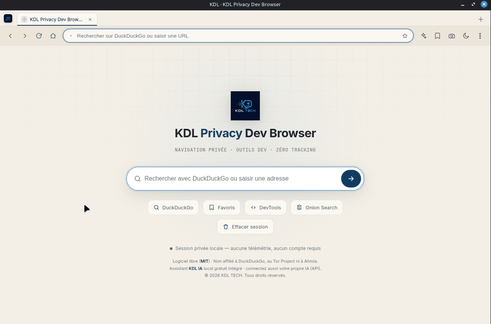

[Français](README.md) · [English](README.en.md) · **Español**

# KDL Privacy Dev Browser

Un navegador de escritorio que no le observa y que ya incluye las herramientas que uno
acaba siempre instalando como extensiones: inspección de páginas, borrado de los datos del
sitio, captura de página completa, modo lectura y auditoría rápida.

```bash
git clone https://github.com/Kdl-Tech/kdl-privacy-dev-browser.git
cd kdl-privacy-dev-browser && npm install && npm start
```



*La interfaz está disponible en francés, inglés y español (captura: francés).*

## Qué hace

| | |
|---|---|
| **Navegación privada** | DuckDuckGo por defecto, historial local mínimo y desactivable, borrado al cerrar, **bloqueador de rastreadores y anuncios integrado** (lista incorporada de 232 dominios, activo por defecto, contador por página), bloqueo opcional de cookies de terceros, sin telemetría |
| **Herramientas de desarrollo** | DevTools de la página, borrado de los datos del sitio con un clic (cookies, caché, local/sessionStorage), captura de página completa, modos escritorio/tableta/móvil, panel de información (URL, título, dominio, HTTPS, user-agent) |
| **Auditoría rápida** | título, meta description, presencia de H1, HTTPS, imágenes sin `alt`, enlaces externos, veredicto general |
| **Modo lectura** | extracción limpia, tres temas, tamaño y ancho ajustables, tiempo de lectura, exportación a Markdown, impresión en PDF |
| **IA local opcional** | modelo ligero local, backend Ollama opcional o su propia clave API — el navegador funciona completamente sin IA |
| **Onion Search** | búsqueda a través del índice público de Ahmia, con traspaso a Tor Browser |
| **Tres idiomas** | interfaz en francés, inglés y español: sigue el idioma del sistema y se cambia en *Privacidad* («Langue / Language / Idioma»); el asistente de IA responde en el idioma elegido |
| **Actualizaciones** | a través de GitHub Releases (electron-updater) |

## Las direcciones .onion no se abren aquí

Un navegador Chromium corriente, ante una dirección `.onion`, intenta resolverla por el DNS
habitual. El servicio oculto sigue siendo inaccesible, por supuesto, pero la petición sí ha
salido en claro hacia su resolvedor y después hacia su operador: lo único que ha conseguido
la operación es revelar lo que usted buscaba.

Por eso este navegador nunca lo intenta. Una dirección `.onion` escrita en la barra muestra
una advertencia y propone la única opción correcta: pasar el testigo a Tor Browser si está
instalado en el equipo. El panel Onion Search, por su parte, consulta el índice **público**
de Ahmia por HTTPS normal — es una página web corriente, no un acceso a la red Tor.

## Endurecimiento de Electron

`contextIsolation: true` · `nodeIntegration: false` · `sandbox: true` · un preload mínimo
que expone una única API acotada (`window.kdl`) · páginas web aisladas en un `<webview>` ·
apertura de ventanas externas redirigida al navegador del sistema mediante
`setWindowOpenHandler` · cámara, micrófono, geolocalización y notificaciones denegados por
defecto · CSP estricta en la interfaz.

Ninguna página visitada puede ejecutar código fuera de su entorno aislado ni acceder al
sistema de archivos.

## Lo que no hace

- **No es un navegador anónimo.** No enruta nada por Tor, no oculta su dirección IP y no
  sustituye a Tor Browser. Evita el rastreo comercial, no la vigilancia dirigida.
- **No es Lighthouse.** La auditoría de página comprueba unos pocos puntos útiles en el día
  a día, no el rendimiento ni la accesibilidad completa.
- **La IA no viene instalada de serie.** No se descarga ningún modelo sin una acción por su
  parte, Ollama nunca se instala automáticamente y la clave API que usted proporcione se
  guarda localmente. El panel de IA no ve sus contraseñas, ni sus cookies, ni sus otras
  pestañas, y pide confirmación antes de cualquier envío remoto.
- **No transmite nada.** Sin cuenta, sin analíticas, sin llamadas a casa.

## Compilar los paquetes

```bash
npm run dist:linux   # AppImage + .deb
npm run dist:win     # NSIS + portable
npm run dist:mac     # dmg
npm run audit:secrets  # comprueba que no quede ningún secreto en el código fuente
```

En Linux, si el entorno aislado de Electron da problemas (Mint sin `chrome-sandbox` setuid):
`npm start -- --no-sandbox`. Evítelo en el uso normal.

## Requisitos

Node.js 18 o superior para el desarrollo. Linux, Windows y macOS para el uso.

## Marcas citadas

DuckDuckGo, Tor Browser y Ahmia se mencionan por lo que son. KDL Privacy Dev Browser
**no está afiliado ni a DuckDuckGo, ni al Tor Project, ni a Ahmia**, y no utiliza ninguno
de sus logotipos.

## Licencia

MIT — véase [LICENSE](LICENSE).

---

**KDL TECH** — reparación informática, desarrollo y herramientas de software.
[kdl-tech.fr](https://kdl-tech.fr)

---

**Editor** — KDL TECH · SIRET 423 471 481 00022 · APE 95.11Z · Guadalupe · [contact@kdl-tech.fr](mailto:contact@kdl-tech.fr) · [kdl-tech.fr](https://kdl-tech.fr) · [Aviso legal](https://kdl-tech.fr/legal.html)
